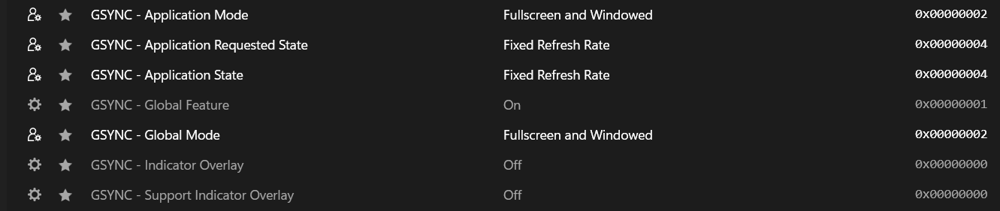

# osu!stable — Fixed Refresh Rate / Visual Pacing Workaround

A **community-reported workaround** for unusually fast-feeling visual pacing and approach-circle presentation in osu!stable, using NVIDIA Profile Inspector.

> **Status:** Confirmed as a subjective improvement on one laptop; the underlying cause has **not** been established. This does not change the actual beatmap speed, Approach Rate (AR), or hit timing.

## Symptoms

On my system, osu!stable felt different despite using the same beatmaps and sensitivity:

- Approach circles seemed to appear later than I was used to.
- The animation felt too fast, even though gameplay was smooth.
- The issue felt visual rather than mouse-related.

## The setting that helped

1. Close osu!stable.
2. Open **NVIDIA Profile Inspector** and select the **osu!** profile. Confirm the profile applies to the actual game executable (`osu!.exe`).
3. **Export/back up your existing profile** before editing it.
4. Record the following **complete set of values from the working profile**:

   | Option | Working value |
   | --- | --- |
   | `GSYNC - Application Requested State` | `Fixed Refresh Rate` |
   | `GSYNC - Application State` | `Fixed Refresh Rate` |
   | `GSYNC - Global Feature` | `On` |
   | `GSYNC - Application Mode` | `Fullscreen and Windowed` |
   | `GSYNC - Global Mode` | `Fullscreen and Windowed` |

   **Important:** The two `Fixed Refresh Rate` rows are the main suspected workaround. The three remaining G-SYNC settings document the configuration present during the successful test; they have **not been independently isolated** as necessary for the improvement. `Global`-named options should not be changed indiscriminately since they may influence behavior beyond this game profile.

5. Click **Apply Changes**, reopen osu!stable, and compare the *same beatmap with the same mods and frame limiter*.

### Screenshot

The screenshot shows the settings used in the successful test, including both application and global G-SYNC modes. It does **not** establish which individual option caused the improvement.

## Test system

| Component | Configuration |
| --- | --- |
| Laptop | ASUS TUF Dash F15 FX516PC |
| GPU | NVIDIA GeForce RTX 3050 Laptop GPU |
| Integrated GPU | Intel Iris Xe Graphics |
| Display | 144 Hz internal display |
| Game | osu!stable |
| Compatibility Mode | Enabled during the reported test |

**Reported outcome:** The original player perceived normal, familiar approach-circle presentation again, without sacrificing smoothness or changing mouse sensitivity.

## What this does *not* prove

- There is no measured evidence here that the game's actual AR, song speed, or object timing changed.
- There is no confirmed diagnosis of G-SYNC or VRR as the root cause. On hybrid-GPU laptops, the internal display may not be driven directly by the NVIDIA GPU, and the driver option may not have an effect on all systems.
- Other settings (refresh rate override, game renderer, FPS limiter, display path, and driver version) can affect perceived visual pacing. One successful test does not establish a universal fix.

## Revert

1. Close osu!stable.
2. In NVIDIA Profile Inspector, restore the saved osu! profile or individually restore the original values of every setting you changed.
3. Click **Apply Changes** and reopen the game.

## Help validate this workaround

If you try it, consider [opening an issue](../../issues/new) and include:

| Field | Your result |
| --- | --- |
| GPU / driver version | |
| Internal or external display; refresh rate | |
| G-SYNC/VRR supported and enabled? | |
| osu!stable Compatibility Mode on/off | |
| FPS limiter and VSync | |
| Before vs. after behavior | |
| Did reverting the change bring the old behavior back? | |

**Suggested A/B/A test:** Record your original profile (A), apply the documented working configuration (B), then restore the original values (A). Keep the beatmap, mods, frame limiter, refresh rate, and osu! version unchanged between tests. A repeated improvement is more informative than a single impression. To isolate the cause, later test one setting at a time.

## Related finding

A separate, earlier community experiment involved osu!stable's refresh-rate override configuration: [osu-stable-refresh-rate-override-fix](https://github.com/malori123321/osu-stable-refresh-rate-override-fix). **It is a different setting and should be tested separately**, not combined with this change in a single A/B test.

---

Unofficial community documentation. Not affiliated with osu! or NVIDIA. Modify driver profile settings at your own discretion.
